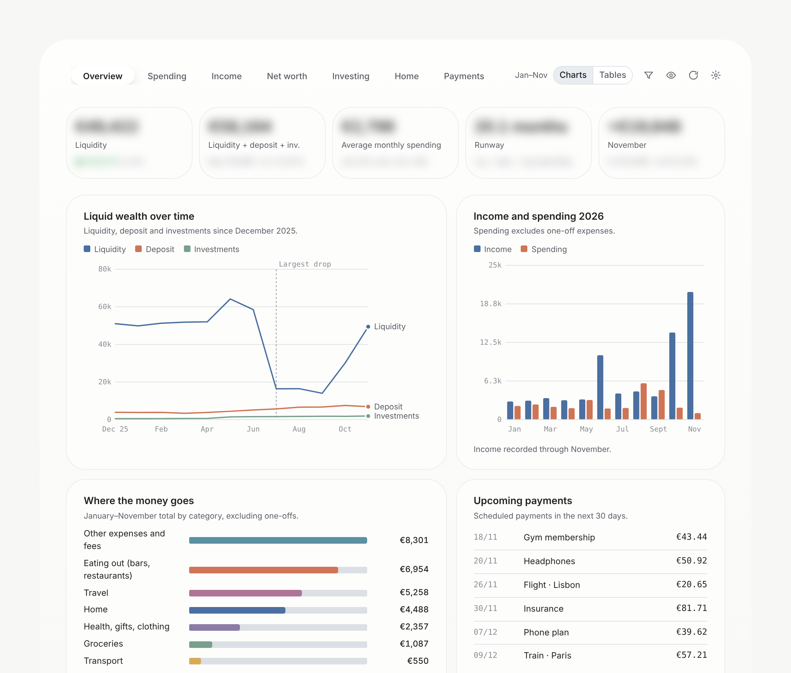

<h1 align="center">Tally</h1>

<p align="center">
  A personal-finance dashboard for <a href="https://obsidian.md">Obsidian</a>.<br>
  Your budget lives in a spreadsheet. Tally turns it into charts and tables, on desktop and phone.
</p>

<p align="center">
  
</p>

> **Personal project, shared as is.** It works with the spreadsheet layout described below, which the templates in this repo already follow. There is no support: issues and pull requests are welcome but may wait.

## What you get

- **Seven views**: Overview, Spending, Income, Net worth, Investing, Home, Payments. A view whose tab is missing from your sheet simply stays empty.
- **Live data**: reads your Google Sheet through **your own** Google credentials, read-only. Or point it at an `.xlsx` inside the vault.
- **Filters everywhere**: period, categories, amount range, search, sort.
- **Two looks**: classic cards, or a flat, dense style. Light and dark, several palettes.
- **Blur amounts** with one button (screen sharing, public places).
- **Phone layout**: tab bar on top, collapsible filters, two-column KPIs.
- **Fast start**: the last saved copy shows instantly, then refreshes in the background.
- **English and Italian** interface.

## Quick start (10 minutes)

1. **Pick a template** from [`template/`](template/):
   - `Tally-template-demo.xlsx`: example data for 10 months. Open it first to see how everything fits together.
   - `Tally-template-empty.xlsx`: the same file without data, ready for your own numbers.
2. **Put it where Tally can read it**:
   - *Google Sheets*: upload the file to Google Drive and open it with Google Sheets (*File → Save as Google Sheets*). Formulas and drop-down menus carry over.
   - *Local file*: copy the `.xlsx` into your vault and choose **File in the vault** in the Tally settings.
3. **Install the plugin**: download `main.js`, `manifest.json` and `styles.css` from the [latest release](https://github.com/Gusions/tally/releases/latest), copy them into `<your vault>/.obsidian/plugins/tally-money/` and enable **Tally** in *Settings → Community plugins*.
4. **Connect your sheet** (next section), or skip it if you chose the local file.
5. Click the wallet icon in the ribbon, or run **Tally: Open dashboard**.

## Connect Google Sheets

Tally never uses a shared server. You create a small Google credential that belongs to you, so your data goes from your Google account to your own computer and nowhere else.

1. Open the [Google Cloud Console](https://console.cloud.google.com/) and create a project (any name).
2. *APIs & Services → Library*: search for **Google Drive API** and click **Enable**.
3. *APIs & Services → OAuth consent screen*: choose **External**, fill in the app name and your email, and add yourself as a test user.
4. *APIs & Services → Credentials → Create credentials → OAuth client ID*: type **Desktop app**. Copy the **Client ID** and **Client secret**.
5. In Obsidian, *Settings → Tally*:
   - **Data source**: Online Google Sheet
   - **Google Sheet link**: the address of your spreadsheet
   - **Google Client ID** and **Google client secret**: paste them
6. Click **Connect Google**, sign in, and approve **read-only** access.

> **The 7-day limit.** While the consent screen is in *Testing* mode, Google expires the sign-in after 7 days and Tally asks you to reconnect. For personal use you can set the app to *In production* (*OAuth consent screen → Publish app*). You will see an "unverified app" warning once, which is expected for your own credential.

> **Phone and tablet.** Google sign-in only works on desktop. On a phone, Tally shows the last copy saved by the desktop, so keep the plugin folder synced between devices.

## Using the spreadsheet

You mostly touch three tabs.

### 1. Categories: teach it once

The **Categories** tab is a list you edit. Each line says "when I type *this*, file it under *that*":

| Entry | Primary | Secondary |
| --- | --- | --- |
| rent | Housing | Rent |
| supermarket | Groceries | Supermarket |
| flight | Travel | Flights |

Add your own lines at the bottom (upper or lower case does not matter). The two short lists on the right (Primary and Secondary) feed the drop-down menus in the expenses tab.

### 2. `2026 Expenses`: one row per expense

Type the **month**, **day**, **expense** name and **amount**. **Primary** and **Secondary** fill in by themselves from the Categories tab. If the name is not in the list, the row is filed as `OtherExpenses / Unknown`: add it to Categories and it is fixed everywhere. To override a single row, pick another value from the drop-down or type over the formula.

The empty template starts with one placeholder row (the dashboard needs at least one). Overwrite it with your first expense.

### `2026 Category`: spending by category (automatic)

A summary like the one you would build by hand: one row per Primary category with its Secondary categories underneath, one column per month, then **Total Spent**, **Income** (from Income History) and **Savings**. It is all formulas on top of the expenses tab, so there is nothing to type. Tally does not read this tab (it computes the same figures itself); it is there for you to look at in the spreadsheet. If you add a new Secondary category in `Categories`, copy any row under its Primary and change the name in column B.

### 3. Overview: balances once a month

One line per account, one column per month (column B is the end of the previous year). Type the balance at month end. The first section (`Cash - Liquidity` in the templates) holds your everyday accounts, and its row called **`Total`** adds them up and drives the main chart: keep it. The other section titles are recognised by their words:

| Title contains | Used for |
| --- | --- |
| `Amex` | Credit-card balance |
| `deposit` | Deposits |
| `invest` | Investments |
| `monitor` | Assets you only watch (pension, company shares) |
| `unclaimed` | Money you are owed |

### The other tabs

| Tab | Required | What goes in it |
| --- | :---: | --- |
| `Start here` | no | A short reminder of the steps above |
| `Investing Trades` | no | One row per purchase: month, date, asset, ticker, amount, fee. Feeds the Investing view: invested over time, amount per instrument, purchases table |
| `Income History` | no | One row per income source, one column per month. A name starting with `Employee` counts as employee income, `Freelance` as freelance income, `Unemployment` as unemployment benefit, anything else as Other. Keep the `Total` row |
| `Scheduled Payments` | no | Upcoming payments: date, amount, description |
| `[CLOSED] BTC`, `[HOUSE] Recap` | no | Closed bitcoin position, home purchase costs and sale scenarios. Not in the templates: they follow the author's own sheets, see `src/parser.ts` |

Tabs are found by **name** (case and punctuation ignored; the tab only has to *contain* the name), so do not rename them.

### Good to know

- **Categories Tally recognises**: `Housing`, `Out`, `Groceries`, `Transport`, `Travel`, `Health`, `Gifts`, `Clothing`, `Fees`, `OtherExpenses`. Any other Primary name still counts, but is shown inside "Other expenses and fees" without warning. Stay with these ten for now.
- **New year**: in January, rename the expenses tab to the new year (`2027 Expenses`). The year is read from the tab name.
- Dates must be real spreadsheet dates and amounts real numbers, not text.
- Labels can be English (the templates) or the original Italian ones: `Total`/`Somma`, `Employee`/`Dipendente`, `Freelance`/`P.IVA`, `Unemployment`/`NASpI`, `Scheduled Payments`/`PAGAMENTI PROGRAMMATI`.
- If something is missing, the dashboard says which tab or row instead of showing wrong numbers.

## Commands

| Command | What it does |
| --- | --- |
| Open dashboard | Opens the dashboard in a tab |
| Create the dashboard note | Adds a note with a ` ```tally ` block (`tab: spending` opens a specific view) |
| Reload | Re-reads the spreadsheet now |

## Customise

Click the gear icon in the dashboard header: look (classic or flat), theme, palette, accent, density, font size, width, currency, decimals, date format, default tab, and which views to show.

## Privacy and security

- **Read-only**: the access scope is `drive.readonly`. Tally never writes to your Drive.
- **Local only**: the sheet is exported to `.xlsx` and parsed on your computer. No analytics, no third-party servers.
- **Your secrets**: the client secret and the sign-in token are stored in the plugin's `data.json` inside your vault. **Do not commit or share that file.** If you sync your vault, exclude `.obsidian/plugins/tally/data.json`.
- A copy of the downloaded sheet is kept as `cache.xlsx` in the plugin folder, so the dashboard opens instantly and works offline. It contains your financial data: treat it like the rest of your vault.

## Troubleshooting

| Message | What to do |
| --- | --- |
| *Google sign-in expired* | Reconnect in the settings. To avoid it, publish the OAuth app (see above). |
| *Missing tab* / *Missing row `Total`* | Check the tab name against the tables above. |
| *No rows found in the expenses tab* | The tab for the current year has no row with a numeric month and amount. |
| Categories look wrong | Check the entry exists in `Categories`; unknown names land in `OtherExpenses`. |
| Dashboard empty on the phone | The desktop has not saved a copy yet: open Tally once on the computer and let the folder sync. |
| Figures look stale | Click the refresh icon. The sheet is re-read every 5 minutes and when you open the dashboard. |

## Development

```bash
npm install
npm run build     # bundle to main.js (esbuild)
npm run check     # type-check
python3 template/build_template.py   # regenerate the two spreadsheet templates (needs openpyxl and LibreOffice)
```

## Changelog

See [CHANGELOG.md](CHANGELOG.md).

## Licence

GPL-3.0-only. See [LICENSE](LICENSE). You can use, study, modify and share Tally; if you distribute a modified version, it must stay under the same licence and its source must be available.
